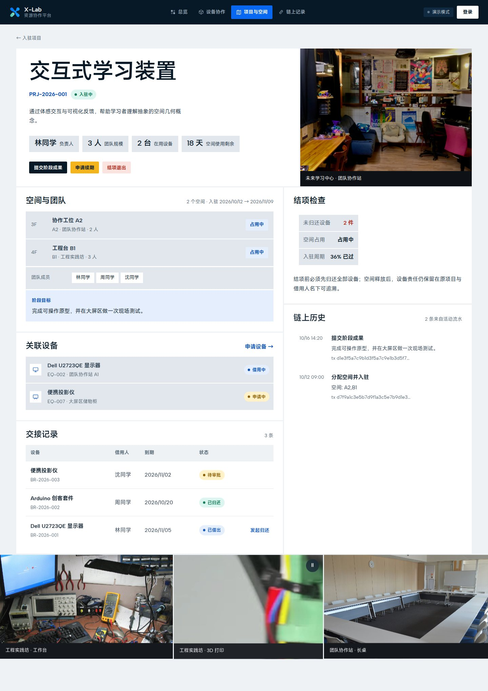

# X-Lab 创新项目入驻与设备协作平台

面向浙江大学未来学习中心的区块链应用。**一条联盟链、一个通道、一个链码**，承载两类业务：
**项目入驻与空间分配**、**设备申请与交接**。两类业务在前端分为独立入口，通过稳定的项目编号关联。

> 课程：《区块链技术应用实践》大作业　|　技术栈：Vue 3 + Go/Gin + Hyperledger Fabric 2.5
>
> 视觉参考 [X-Lab 官方品牌](https://www.zjuxlab.com/)，素材来源与授权说明见
> [`frontend/public/media/credits.json`](frontend/public/media/credits.json) 和 [`docs/media-credits.md`](docs/media-credits.md)。

---

## 一、这个系统解决什么问题

X-Lab 管理未来学习中心的实体空间与设备。现实中存在三个断裂：

1. **空间**：谁因为什么 idea 获得了哪些工位、能用到什么时候、承诺产出什么——散落在表格和聊天记录里。
2. **设备**：相机、镜头、3D 打印机、工作站借出后，谁在什么时候领的、附件齐不齐、归还时状态如何——靠人记账。
3. **关联**：项目退出时，需要同时释放空间**和**核对未归还设备，但这两件事在不同系统里。

系统把三者串成一条可核验的责任链：

```
提交 idea  →  评审  →  分配工位  →  确认入驻约定
                            │
                            └──项目编号──→ 申请设备 → 审批 → 双方领取 → 使用 → 归还验收
                                                              │
                                                    每次操作写入链上，留下 TxID
```

**为什么需要联盟链而不是普通数据库**（答辩必问）：

当前网络包含资源管理委员会（Org1）与项目团队（Org2）两个独立组织；设备保管人是
Org1 内的业务角色。用中心化数据库，管理方可以单方面改记录、删记录，项目团队无法自证。
上链后每一次审批、领取、验收都留下带组织签名的交易，任何一方都能独立核验，
同时**审核权与交接确认权通过组织身份（MSP）在链码层强制隔离**——越权调用直接被拒绝。
若后续需要让设备保管方独立背书，可再拆分为第三个 MSP。

---

## 二、快速开始

### 环境要求

- 演示模式：Go 1.21+、Node.js 20+、npm、Bash
- Fabric 模式：另需 Docker、Hyperledger Fabric 2.5 的 fabric-samples/test-network
- 建议从仓库根目录执行脚本；依赖版本由 go.sum 和 package-lock.json 锁定

### 方式 A：演示模式（推荐，不需要 Fabric）

```bash
./deploy/run.sh demo
# 打开 http://127.0.0.1:18088
```

脚本会安装前端依赖、构建 Vue 页面、编译 Go 后端，再用单端口启动。
演示模式使用内存账本，**完整业务流程都能跑通**，适合本地体验和答辩兜底。
仅执行 `cd backend && go run .` 时，干净克隆中因没有 `frontend/dist` 而只会启动 API。

### 方式 B：完整模式（真实上链）

```bash
./deploy/up.sh           # 启动网络 + 通道 + 部署链码 + 初始化台账
./deploy/run.sh fabric   # 构建前端 + 编译后端，单端口 18088 托管
# 打开 http://127.0.0.1:18088
```

`run.sh` 会把构建产物和后端放在同一端口，答辩时只需开一个地址；
`dev.sh fabric` 则是后端单独跑在 8088、前端另开 5173 热更新，适合改代码。

### 方式 C：前端开发模式（热更新）

```bash
./deploy/dev.sh backend    # 终端 1
./deploy/dev.sh frontend   # 终端 2 → http://127.0.0.1:5173
```

### 演示账号

总览、设备、空间和链上记录可公开浏览；提交与管理等写操作需要登录。两个演示账号对应链上两个组织：

| 账号 | 密码 | 身份 | 链上组织 | 权限范围 |
|---|---|---|---|---|
| `admin` | `xlab2026` | 资源管理委员会 | Org1MSP | 评审 idea、分配空间、审批借用、交接确认、异常处理 |
| `team` | `xlab2026` | 入驻项目团队 | Org2MSP | 提交入驻申请、申请借用、提交成果、发起归还 |

**权限是三层校验的**：

1. **前端**：团队身份看不到「管理台」入口，直接输入 `/console` 会被路由守卫拦回首页
2. **接口**：管理类接口在 Gin 中间件校验角色，越权返回 403
3. **链码**：按 `GetMSPID()` 校验组织身份，越权交易被背书节点拒绝

因此即使绕过前端直接调接口，链码层仍会拦截——这是联盟链区别于普通数据库的关键。

### 提交前检查

```bash
./deploy/check.sh
```

脚本会依次检查 Git 补丁、后端、链码、前端生产构建以及全部部署脚本语法。

---

## 三、系统架构

```
┌───────────────────────────────────────────────────────────────┐
│  浏览器                                                       │
│  Vue 3 + Vite + Pinia + Vue Router                            │
│  ├─ 总览        资源状态、链上动态                             │
│  ├─ 设备协作    设备台账、申请借用、设备详情、交接历史           │
│  ├─ 项目入驻    楼层平面图、空间点选、入驻申请                   │
│  ├─ 项目详情    空间 + 设备 + 成果 + 链上历史（两套业务联动点）   │
│  ├─ 管理台      评审、分配空间、借出审批、领取、验收、异常        │
│  └─ 链上浏览    交易哈希、区块视图、操作分布                    │
└──────────────────────────┬────────────────────────────────────┘
                           │ HTTP / JSON
┌──────────────────────────▼────────────────────────────────────┐
│  Go 后端（Gin）                                                │
│  ├─ Store 接口（两种实现，接口不变）                            │
│  │   ├─ memoryStore  演示模式，内存账本                         │
│  │   └─ fabricStore  Fabric Gateway（gRPC + TLS + X509）       │
│  ├─ 业务规则：状态机校验、空间日期冲突、结项前设备核对           │
│  └─ 静态托管前端构建产物（同源，无 CORS）                       │
└──────────────────────────┬────────────────────────────────────┘
                           │ gRPC 7051 / 9051
┌──────────────────────────▼────────────────────────────────────┐
│  Hyperledger Fabric（test-network）                            │
│  channel: xlabchannel    chaincode: xlab                      │
│  ├─ Org1MSP  X-Lab 资源管理委员会（管理方）                     │
│  └─ Org2MSP  入驻项目团队（使用方）                             │
│  CCAAS 模式：链码作为独立容器，peer 按 connection.json 连接      │
└───────────────────────────────────────────────────────────────┘
```

### 为什么用 CCAAS 部署链码

项目开发环境中 Docker Engine 29.x 要求 API ≥ 1.44，而 Fabric peer 内置的 Docker 客户端版本较旧，
peer 直接 `docker build` 链码镜像会报 `write unix @->/run/docker.sock: broken pipe`。
CCAAS（Chaincode-as-a-Service）由我们先构建镜像、peer 只负责连接，完全避开该问题，
同时启动更快、更稳定，适合答辩现场。部署脚本已自动处理。

---

## 四、链上设计

### 对象与键前缀

| 前缀 | 对象 | 说明 |
|---|---|---|
| `EQUIPMENT:` | 设备台账 | 含附件清单、保管人、当前借用单 |
| `SPACE:` | 空间单元 | 含楼层、容量、平面图坐标 |
| `APPLICATION:` | 入驻申请 | idea 摘要 + 哈希、评审结果 |
| `PROJECT:` | 已入驻项目 | 空间、期限、阶段成果、续期次数 |
| `ALLOCATION:` | 空间占用区间 | 起止日期，用于冲突检测 |
| `BORROW:` | 设备交接单 | 申请 / 审批 / 领取 / 归还全程 |
| `ACTIVITY:` | 操作流水 | 每笔操作的审计轨迹（以 TxID 为键） |

### 状态机

**设备**
```
AVAILABLE → REQUESTED → APPROVED → BORROWED → RETURN_REQUESTED → RETURNED
                                                              ↘ EXCEPTION → 处理 → AVAILABLE
```

**项目入驻**
```
SUBMITTED → APPROVED → ACTIVATED（分配空间）→ ACTIVE
                                          ├→ EXTENDED（续期）
                                          └→ CLOSED（结项，需先归清设备）
SUBMITTED → REJECTED
```

### 权限（链码层强制）

| 函数 | 允许组织 | 说明 |
|---|---|---|
| `InitLedger` / `CreateSpace` / `CreateEquipment` | **Org1** | 台账维护 |
| `ReviewProjectApplication` / `ActivateProject` | **Org1** | 评审与分配 |
| `ExtendProject` / `CloseProject` | **Org1** | 续期与结项 |
| `ReviewEquipmentBorrow` / `ConfirmEquipmentPickup` / `ConfirmEquipmentReturn` | **Org1** | 审批与交接确认 |
| `SubmitProjectApplication` / `RequestEquipmentBorrow` | **Org2** | 申请人 |
| `SubmitMilestone` / `RequestEquipmentReturn` | **Org2** | 使用方发起 |
| 所有 `Get*` / `Read*` | 不限 | 查询 |

越权调用返回：
```
权限不足：该操作仅允许 Org1MSP 执行，当前身份 …（Org2MSP）
```

### 关键业务规则

- **同一设备不能重复借出**：`RequestEquipmentBorrow` 校验状态必须为 `AVAILABLE`
- **空间时间不重叠**：`hasSpaceConflict` 按起止日期做区间相交判断，同一工位可在不同时段分配给不同项目
- **结项前必须归清设备**：`CloseProject` 统计未归还借用单，大于 0 则拒绝
- **已完成的交接不能修改**：状态机只允许单向流转，更正走追加记录
- **链上链下分离**：链上只存主键、状态、摘要哈希、确认人与时间；idea 正文、照片、成果文件留在链下

---

## 五、功能清单

| 模块 | 功能 |
|---|---|
| **设备协作** | 设备台账（28 台）、搜索筛选、借用申请、设备详情、交接记录、链上变更历史、逾期标记 |
| **项目入驻** | 楼层平面图（3F/4F）、空间点选、入驻申请、项目卡片、待评审列表 |
| **项目详情** | 空间与团队、关联设备、交接记录、阶段成果、续期、结项（含设备核对）、链上历史 |
| **管理台** | 六类待办：入驻评审 / 待分配空间 / 借出审批 / 待领取 / 待验收 / 异常 |
| **链上浏览** | 全量交易、交易详情（TxID / 组织 / 时间）、操作分布、区块视图 |
| **权限演示** | 管理方 ↔ 项目团队身份切换 |

### 界面

<table>
<tr>
<td width="50%"><br><sub>登录：实景轮播 + 身份选择</sub></td>
<td width="50%"><br><sub>首页：项目、空间与设备 + 当前资源概况</sub></td>
</tr>
<tr>
<td><br><sub>设备：按类别分册，一行一台</sub></td>
<td><br><sub>空间：平面图 + 在驻项目</sub></td>
</tr>
<tr>
<td><br><sub>项目详情：空间、设备、结项检查</sub></td>
<td><br><sub>链上记录：全量流水与区块视图</sub></td>
</tr>
</table>

后台管理台与设备详情见 [console.jpg](docs/screenshots/console.jpg)、[eqdetail.jpg](docs/screenshots/eqdetail.jpg)。

> 视觉取舍过程记录在 [docs/design-options/](docs/design-options/)：曾试过「整幅色场海报」与「档案册」两种方向，最终按答辩场景选了当前这套——顶部导航、深色主视觉、清单式资源台账与克制的圆角，兼顾识别度和信息密度。

---

## 六、目录结构

```
xlab-platform/
├── chaincode/                 Fabric Go 链码
│   ├── contract.go            合约实现（数据模型 + 状态机 + 权限，28 个合约函数）
│   ├── main.go                入口（标准模式 / CCAAS 模式）
│   ├── vendor/                依赖（离线可编译）
│   └── xlab-ccaas.tar.gz      CCAAS 链码包（脚本生成）
├── backend/                   Go + Gin 后端
│   ├── main.go                路由与服务启动
│   ├── handlers.go            HTTP 处理器
│   ├── auth.go                会话、角色中间件、按组织签名
│   ├── store.go               Store 接口 + memoryStore（演示）
│   ├── fabric.go              fabricStore（Gateway，Org1/Org2 双身份）
│   ├── seed.go                演示种子数据
│   └── types.go               领域模型（与链码字段一致）
├── frontend/                  Vue 3 前端
│   ├── src/views/             8 个页面（含登录与两个详情页）
│   ├── src/components/        AppModal / AmbientVideo / StatusChip / Timeline
│   │                          CatIcon / XLabLogo / CountUp（数字滚动）
│   ├── src/lib/               store(Pinia) / auth / labels / reveal(入场)
│   │                          motion(减弱动态) / pointer(指针倾斜) / parallax(视差)
│   └── public/media/          实景照片与视频（来源见 media/credits.json）
├── deploy/
│   ├── up.sh                  一键部署 Fabric + 链码（up|down|current）
│   ├── run.sh                 构建并启动单端口服务（:18088）
│   ├── dev.sh                 开发模式启动
│   ├── check.sh               提交前全量检查
│   ├── docker/Dockerfile.ccaas 链码镜像
│   └── ccaas/                 CCAAS 包模板
└── docs/
    ├── screenshots/           全部页面截图（README 画廊引用）
    ├── design-options/        视觉方案取舍记录
    ├── product-design.md      产品与链上设计
    ├── implementation-roadmap.md 实施路线
    ├── 项目介绍.md            作业交付：项目介绍文档
    ├── 答辩PPT.md             作业交付：答辩演示骨架
    ├── 组员分工.md            作业交付：分工与贡献值
    ├── GitHub发布清单.md       公开仓库发布前检查
    └── media-credits.md       素材授权说明
```

---

## 七、接口一览

| 方法 | 路径 | 说明 | 权限 |
|---|---|---|---|
| POST | `/api/auth/login` | 登录，返回 token 与用户信息 | 公开 |
| GET | `/api/auth/me` | 校验会话 | 登录 |
| POST | `/api/auth/logout` | 退出登录 | 登录 |
| GET | `/api/health` | 健康检查，返回当前模式 | 公开 |
| GET | `/api/ledger` | 全量账本快照 | 公开 |
| GET | `/api/history/:type/:id` | 单对象链上变更历史 | 公开 |
| GET | `/api/chain` | 区块高度与区块摘要 | 公开 |
| POST | `/api/applications` | 提交入驻申请 | 登录 |
| POST | `/api/projects/:id/milestone` | 提交阶段成果 | 登录 |
| POST | `/api/borrows` | 提交借用申请 | 登录 |
| POST | `/api/borrows/:id/return-request` | 发起归还 | 登录 |
| POST | `/api/applications/:id/review` | 评审 | 仅 Org1 |
| POST | `/api/applications/:id/activate` | 分配空间并入驻 | 仅 Org1 |
| POST | `/api/projects/:id/extend` | 续期 | 仅 Org1 |
| POST | `/api/projects/:id/close` | 结项（有设备未还则拒绝） | 仅 Org1 |
| POST | `/api/borrows/:id/review` | 审批借用 | 仅 Org1 |
| POST | `/api/borrows/:id/pickup` | 确认领取 | 仅 Org1 |
| POST | `/api/borrows/:id/return-confirm` | 归还验收 | 仅 Org1 |
| POST | `/api/borrows/:id/resolve` | 异常处理完毕 | 仅 Org1 |

---

## 八、数据说明

演示台账包含 **28 台设备**（MacBook Pro、Dell 显示器、索尼 A7M4 + 24-70 GM2、Rode 麦克风、
Bambu Lab P1S 3D 打印机、Arduino 套件、示波器、Meta Quest 3、Mac Studio、DJI 稳定器、补光灯、录音设备等）和
**18 个空间**（6 个协作工位、4 个工程台、大屏区、路演小厅、影视区、录音棚、灵感讨论角、头脑风暴室、休闲补给站、共享厨房）。

分区名称取自 X-Lab 真实内装方案（团队协作站 / 工程实践坊 / 大屏区 / 影视区 / 灵感讨论角 / 休闲补给站）。
设备型号为面向课程演示设计的示例清单，**不是实际采购台账**；正式使用时替换
`backend/seed.go` 与链码 `InitLedger` 即可，页面与合约模型无需改动。

---

## 九、答辩要点

### 7 分钟演示脚本

| 时间 | 内容 |
|---|---|
| 0:00–0:50 | 问题：空间与设备管理靠表格和群消息，多方对不上账 |
| 0:50–1:40 | 架构：一条链、一个通道、两个入口、项目编号联动 |
| 1:40–3:00 | 提交 idea → 管理台评审 → 平面图上分配工位（演示时间冲突被拒） |
| 3:00–4:00 | 以项目名义借设备 → 审批 → 领取交接 |
| 4:00–5:00 | 项目详情页：空间 + 设备 + 交接记录一屏汇总 |
| 5:00–5:40 | 结项校验：还有设备没还 → 被拒绝 |
| 5:40–6:30 | 链上浏览：真实 TxID、组织身份、区块视图 |
| 6:30–7:00 | **切到 Org2 身份调用管理员函数 → 权限不足被拒** |

### 必问 Q&A

1. **为什么不用普通数据库？**
   管理方与项目团队需要独立核验；审批与交接记录带组织签名，任何一方无法单方面篡改。

2. **为什么一条链而不是两条？**
   项目是空间与设备的共同主体；退出时需同时释放空间并核对设备。一个通道两个业务模块即可，
   拆成两条链只会增加部署与查询复杂度，且第一版没有账本级隔离需求。

3. **链上存了什么，链下存了什么？**
   链上：主键、状态、摘要哈希、确认人、时间戳。链下：idea 正文、设备照片、成果文件、搜索索引。

4. **怎么保证同一设备不被重复借出？**
   RequestEquipmentBorrow 校验设备状态必须为 AVAILABLE；并发交易即使都完成背书，
   在区块验证阶段也会因同一设备键的 MVCC 版本冲突而只保留一个有效写入。

5. **工位冲突怎么判断？**
   按 `SpaceAllocation` 起止日期做区间相交（`start < otherEnd && end > otherStart`），
   而不是压成"占用/空闲"的布尔值，因此支持未来排期。

6. **权限是怎么实现的？**
   链码读 `ctx.GetClientIdentity().GetMSPID()`，写操作按组织白名单校验。
   页面身份切换只是演示，真正的拦截在链码里——现场可用 `peer chaincode invoke` 直接验证。

7. **和 fabcar 有什么区别？**
   fabcar 是单合约 CRUD 示例；本项目是**多组织权限 + 双业务状态机 + 跨模块引用完整性校验
   （结项必须归清设备）+ 审计流水**。

---

## 十、已知限制与后续方向

- 设备照片与成果文件当前只记录哈希，未接入对象存储（可扩展为 MinIO / OSS）
- 空间为楼层级简化平面图，未做 CAD 级建模与小时级预约
- 未实现押金、门禁与智能柜硬件联动
- 未做多通道与私有数据集合（Private Data Collection）
- 成员考评与信用分未纳入链上

---

## 十一、开发记录

本项目在课程实验（hw1–hw7）基础上完成。关键问题与解决：

| 问题 | 现象 | 解决 |
|---|---|---|
| 链码 Go 版本 | `go.mod` 声明 1.23，Fabric ccenv 为 go1.18，`invalid go version` | 降到 `fabric-contract-api-go v1.2.0`，`go 1.13` |
| gRPC 依赖 | `grpc@v1.67` 使用 `maps`/`slices`（Go 1.21+） | 固定 v1.48，与 ccenv 兼容 |
| 链码 schema 校验 | `currentBorrowId is required` / `pickupPhotos: Expected array, given null` | 移除 `omitempty`；切片字段归一化为 `[]string{}` |
| Docker 版本 | peer 构建链码报 `broken pipe` | 改用 CCAAS，自行构建镜像 |
| CCAAS 注册 | `peer will not accept external chaincode connection` | CCID 必须为 `label:packageID` 全格式 |
| 空间冲突 | 同一工位重复分配 | 区间相交判断 + 已占用空间在 UI 禁用 |
| 空间统计 | 首页显示「10 处可分配」，平面图上却已占了 4 间 | `GetStats` 改为遍历 `SpaceAllocation` 统计实际占用，与平面图同一口径 |
| 链上历史 | 时间轴上每条都写「链上记录」 | `GetHistoryForKey` 返回的是状态快照，改读 `logActivity` 写入的活动流水 |
| 错误信息 | 结项失败只显示 `failed to endorse transaction` | 从 gRPC status details 解出链码原文，如「项目仍有 1 件设备未归还」 |
| 前端数据不加载 | 所有页面首次进入都是空列表 | `store.js` 的 `loading` 初值为 `true`，把「首拉」守卫卡死了 |
| 设备详情历史为空 | 设备详情的时间轴一条都没有，项目详情却有 | 借用类事件的 `objectId` 是借用单号而非设备号，改为按 `[设备号, ...关联借用单号]` 匹配 |
| 链上身份不可读 | 「更新者」一栏是一串 base64，解出来才知道是 `CN=User1@org1.example.com` | `labels.js` 加 `whoIs()`，解序列化身份只取 CN 与 O，显示为「User1 · Org1」 |
| 手机端横向溢出 | 项目页被撑到 451px、链上页 525px（视口 390） | grid 子项补 `min-width: 0`；表格 `table-layout: fixed` 并裁掉次要列；筛选段与元信息条允许换行 |
| 手机端导航压字 | 底部工具带盖住正文末行，大字被判定为完全遮挡 | 导航由沉底改吸顶（`fixed; top: 0; height: 58px`），`.stage` 顶部让出 58px |
| 调用方全是委员会 | 链上流水的「调用方」一栏 28 条全是委员会，团队提交的申请也记在 Org1 名下 | 后端为 Org1/Org2 各建一份 Gateway 连接，按登录用户所属组织签名（`ActorAware.For()`），现在团队操作记为 `Org2MSP` |
| 业务对象不可辨认 | 流水里全是 `PRJ-1792...`、`BR-1792...`，编号是时间戳，截断后彼此无法区分 | 后端补查项目/设备名，列表显示「设备名 + 完整编号」两行，调用方加组织色点 |

---

## 十二、仓库提交约定

- 提交源码、锁文件、文档、必要媒体和离线链码依赖。
- 不提交 `node_modules`、`frontend/dist`、Go 可执行文件、链码压缩包、日志和设计验收临时截图；这些内容均可由脚本重新生成。
- 新环境使用 `npm ci` 安装锁定版本，答辩前运行 `./deploy/check.sh`。
- Fabric 证书与用户私钥来自本地 `fabric-samples/test-network`，不得复制进本仓库。

更完整的文档入口见 [`docs/README.md`](docs/README.md)，公开发布步骤见
[`docs/GitHub发布清单.md`](docs/GitHub发布清单.md)。当前鉴权与网络配置面向课程演示，
不应直接用于公网生产环境，详见 [`SECURITY.md`](SECURITY.md)。
