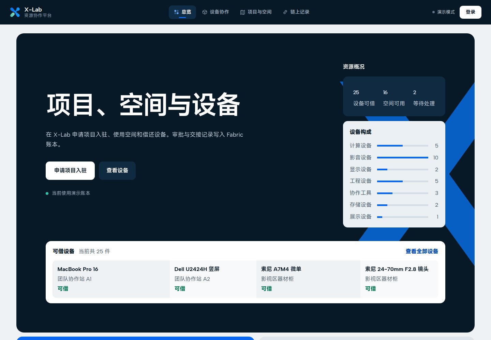
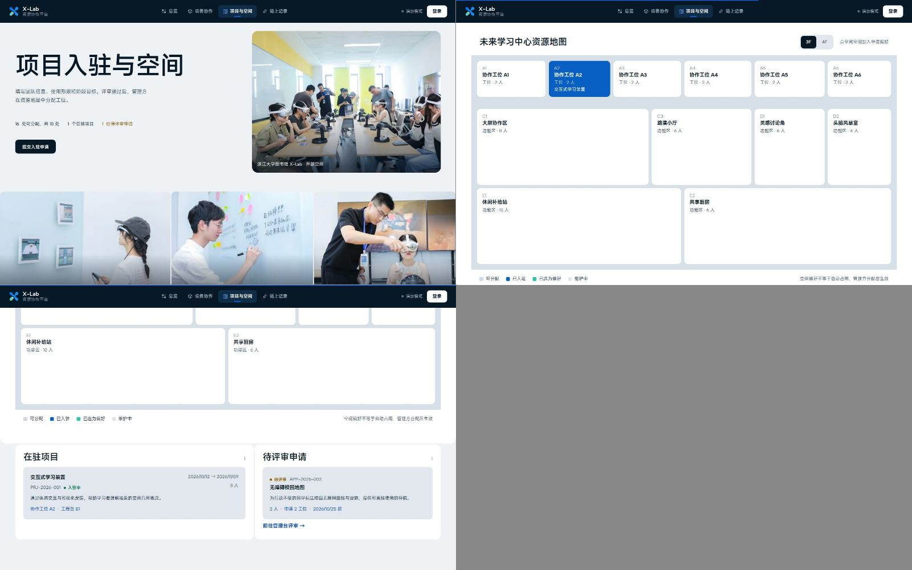
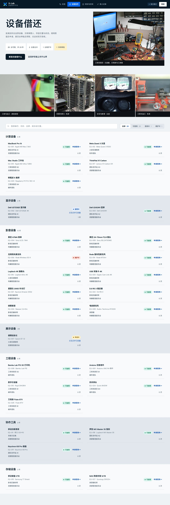
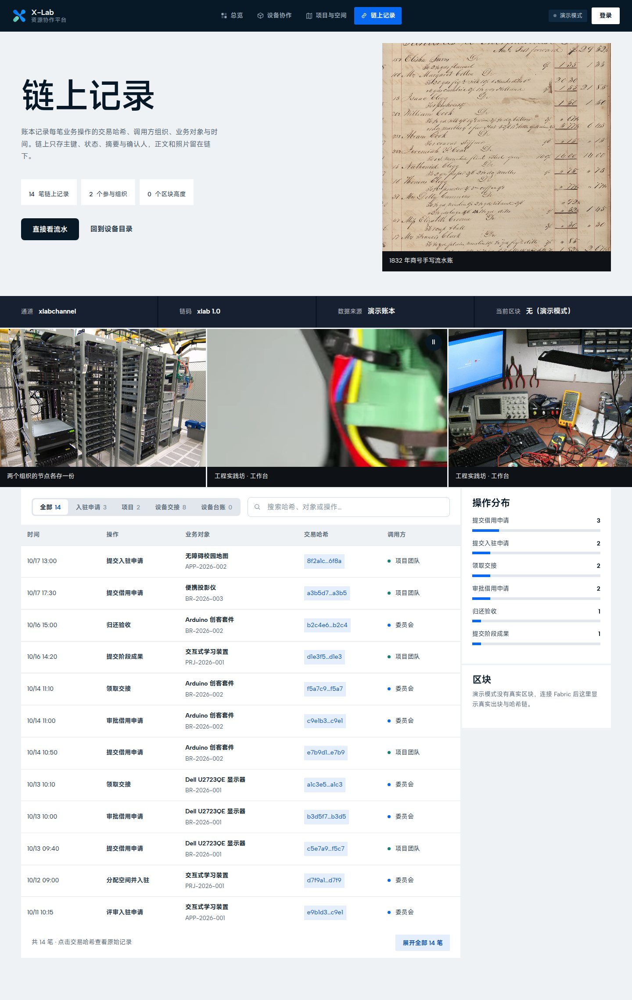

# X-Lab 创新项目入驻与设备协作平台

这是一个为浙江大学未来学习中心 X-Lab 设计的项目入驻与资源管理原型，包含项目申请、空间分配、设备借用和交接记录。需要多方确认的状态变更由 Hyperledger Fabric 记录。

当前 Fabric 网络使用 `xlabchannel` 通道和 `xlab` 链码。空间与设备在界面上各有独立入口，并通过项目编号关联；存在设备未归还时，项目不能结项。

## 界面预览

<table>
<tr>
<td width="50%"><br><sub>首页与资源概况</sub></td>
<td width="50%"><br><sub>空间地图与入驻项目</sub></td>
</tr>
<tr>
<td><br><sub>设备台账与借用状态</sub></td>
<td><br><sub>交易记录与区块信息</sub></td>
</tr>
</table>

## 主要功能

- 项目团队提交入驻申请，管理方完成评审并分配空间
- 3F、4F 空间地图浏览、空间偏好选择和时间冲突检查
- 设备检索、借用申请、审批、领取、归还和异常处理
- 项目、空间与设备记录按项目编号汇总
- Org1、Org2 两类组织身份与链码级权限控制
- 交易流水、TxID、调用组织和区块摘要查询
- 内存账本与 Fabric Gateway 两种运行方式

## 快速开始

### 环境要求

- Go 1.21 或更高版本
- Node.js 20 或更高版本
- npm、Bash
- Fabric 模式还需要 Docker 和 Hyperledger Fabric 2.5 `fabric-samples/test-network`

### 本地模式

本地模式以进程内存保存数据，不依赖 Fabric。

```bash
./deploy/run.sh demo
```

启动完成后访问 [http://127.0.0.1:18088](http://127.0.0.1:18088)。脚本依次安装前端依赖、构建 Vue 应用并启动 Go 服务。

### Fabric 模式

```bash
./deploy/up.sh
./deploy/run.sh fabric
```

`up.sh` 会启动 Fabric 测试网络、创建 `xlabchannel`、部署 `xlab` 链码并初始化台账。服务仍运行在 `18088` 端口。

停止网络：

```bash
./deploy/up.sh down
```

### 前端开发

分别启动后端和 Vite 开发服务器：

```bash
./deploy/dev.sh backend
./deploy/dev.sh frontend
```

前端开发地址为 [http://127.0.0.1:5173](http://127.0.0.1:5173)。

## 本地体验账号

查询页面可以直接浏览，提交申请和管理操作需要登录。

| 账号 | 密码 | 身份 | Fabric 组织 |
|---|---|---|---|
| `admin` | `xlab2026` | 资源管理方 | `Org1MSP` |
| `team` | `xlab2026` | 入驻项目团队 | `Org2MSP` |

这些账号只用于本地运行。认证实现、公开部署前的必要改动见 [SECURITY.md](SECURITY.md)。

## 系统结构

```text
Vue 3 / Vite / Pinia
        │ HTTP + JSON
        ▼
Go / Gin API
        │
        ├── memoryStore ── 内存账本
        │
        └── fabricStore ── Fabric Gateway / gRPC / TLS
                                  │
                                  ▼
                    xlabchannel / xlab chaincode
                         Org1MSP ↔ Org2MSP
```

后端通过统一的 `Store` 接口连接两种账本实现，页面和 HTTP 接口不需要因运行模式而改变。Fabric 模式为 Org1 和 Org2 分别创建 Gateway 连接，交易由当前登录用户所属组织签名。

链码使用 Chaincode-as-a-Service（CCAAS）部署。链码容器由部署脚本构建和启动，Peer 根据 `connection.json` 连接，避免 Fabric 内置 Docker 客户端与新版 Docker Engine 的兼容问题。

## 业务模型

项目入驻流程：

```text
SUBMITTED → APPROVED → ACTIVATED → ACTIVE
    │                                  ├── EXTENDED
    └────────────→ REJECTED            └── CLOSED
```

设备借用流程：

```text
AVAILABLE → REQUESTED → APPROVED → BORROWED
                                      │
                                      ▼
                              RETURN_REQUESTED → RETURNED
                                      └────────→ EXCEPTION → AVAILABLE
```

链码约束：

- 只有 `AVAILABLE` 状态的设备可以发起借用
- 同一空间的占用时间不能重叠
- 项目仍有关联设备未归还时不能结项
- 管理操作只接受 `Org1MSP` 身份，团队申请只接受 `Org2MSP` 身份
- 已完成的交接记录不能覆盖修改；更正以新的活动记录追加

### 链上数据

| 键前缀 | 内容 |
|---|---|
| `APPLICATION:` | 入驻申请与评审结果 |
| `PROJECT:` | 入驻项目、期限和阶段成果 |
| `SPACE:` / `ALLOCATION:` | 空间信息与占用区间 |
| `EQUIPMENT:` | 设备状态与当前借用单 |
| `BORROW:` | 借用、领取和归还记录 |
| `ACTIVITY:` | 以 TxID 标识的操作流水 |

链上保存业务主键、状态、摘要哈希、确认人和时间。申请正文、照片与成果文件等体积较大的内容应放在链下存储。

## 目录结构

```text
xlab-platform/
├── frontend/       Vue 3 前端
├── backend/        Gin API、认证与两种 Store 实现
├── chaincode/      Fabric Go 链码与离线依赖
├── deploy/         本地运行、网络部署和检查脚本
├── docs/           产品、实现、截图与补充材料
├── README.md
└── SECURITY.md
```

代码入口：

- `frontend/src/views/`：首页、设备、空间、项目、管理台和链上记录页面
- `backend/main.go`：服务入口和路由注册
- `backend/store.go`：存储接口与内存实现
- `backend/fabric.go`：Fabric Gateway 实现
- `chaincode/contract.go`：数据模型、状态机和权限规则
- `deploy/up.sh`：Fabric 网络与 CCAAS 链码部署

## API 概览

| 路径 | 用途 |
|---|---|
| `/api/auth/*` | 登录、会话查询与退出 |
| `/api/ledger` | 当前账本快照 |
| `/api/chain` | 区块高度与区块摘要 |
| `/api/history/:type/:id` | 指定对象的变更历史 |
| `/api/applications/*` | 入驻申请、评审与空间分配 |
| `/api/projects/*` | 阶段成果、续期与结项 |
| `/api/borrows/*` | 设备申请、审批、领取与归还 |

写入请求先由后端检查登录角色，管理类接口对非管理账号返回 `403`。Fabric 模式下，链码还会在背书阶段按 MSP 验证调用方。

## 示例数据

本地账本预置 18 处空间和 28 台设备，用来覆盖搜索、申请、冲突检查、交接和结项流程。空间分区参考 X-Lab 的公开资料；设备型号和资产编号是示例数据，不代表实际采购台账。

修改下列文件可替换预置数据：

- `backend/seed.go`：本地模式
- `chaincode/contract.go` 中的 `InitLedger`：Fabric 模式

## 开发与检查

提交代码前运行：

```bash
./deploy/check.sh
```

检查内容包括 Go 后端、链码、前端生产构建、Git 补丁格式和部署脚本语法。

仓库不包含 `node_modules`、前端构建产物、Go 可执行文件、Fabric 证书和用户私钥。链码依赖保存在 `chaincode/vendor/`，无网络环境也能编译。

## 文档

- [产品与链上设计](docs/product-design.md)
- [实现路线与工程记录](docs/implementation-roadmap.md)
- [界面方案记录](docs/design-options/)
- [图片与视频来源](docs/media-credits.md)
- [安全与部署边界](SECURITY.md)
- [文档目录](docs/README.md)

## 尚未实现

- 空间地图是业务示意图，不是 CAD 图纸，也未实现小时级预约
- 文件目前只记录摘要信息，尚未接入对象存储
- 暂未接入统一身份认证、门禁、智能柜或押金系统
- 当前网络使用两个组织和单通道，未启用私有数据集合

图片、视频和 X-Lab 品牌素材的来源及使用说明见 [docs/media-credits.md](docs/media-credits.md) 和 [frontend/public/media/credits.json](frontend/public/media/credits.json)。
